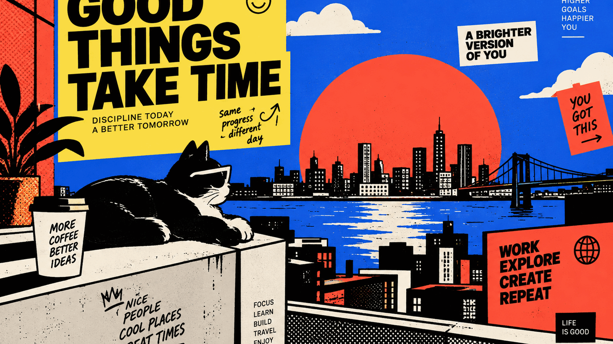

# Neo Brutalism

A screenprint poster on ink. Flat primaries, zero radius, hard edges, nothing
blended that didn't earn it.



## Install

```bash
omarchy theme install https://github.com/TarasKim/omarchy-neo-brutalism-theme
```

Then pick **Neo Brutalism** from `omarchy theme set` or the Style menu.

## Palette

| Role | Hex | |
|------|-----|--|
| background | `#0E0D0B` | ink |
| foreground | `#F1E7D5` | paper cream |
| accent | `#FA4F37` | signal red |
| selection | `#105AE1` | electric blue |
| yellow | `#FADD45` | cadmium |

The blue used for *text* is lifted to `#4C8DFF`. The poster's true `#105AE1`
only reaches 3.3:1 against the ink background, which fails WCAG AA for body
text, so it is kept for blocks and selections where it works and replaced
where it doesn't.

Green, cyan and magenta don't appear in the source artwork. They're mixed to
sit in the same flat screenprint register so a 16-colour terminal is complete
without drifting off-palette.

## What's in it

- `colors.toml` — drives the terminal, btop, Chromium, Helix, Neovim, VS Code,
  Obsidian and the whole Omarchy shell
- `shell.toml` — bar, menu, launcher, notifications, polkit, lock, OSD
- `hyprland.lua` — 0 radius, 4px border, sharp offset shadow *(see below)*
- `icons.theme` — `Yaru-red-dark`
- `unlock.png` / `preview-unlock.png` — boot and unlock screen
- 5 backgrounds

## The window chrome is optional

`omarchy theme install` deliberately drops any `.lua` a theme ships, because
that is code your compositor would run at login. The colours all survive — the
red-to-yellow focused border comes from `hyprland_active_border` in
`colors.toml` and is regenerated on your machine.

What does not survive is the geometry. If you want the full brutalist chrome,
paste this into your own `~/.config/hypr/looknfeel.lua`:

```lua
hl.config({
  general = { border_size = 4, gaps_in = 6, gaps_out = 10 },
  decoration = {
    rounding = 0,
    blur = { enabled = false },
    shadow = {
      enabled = true, sharp = true, range = 10,
      offset = "8 8", render_power = 1,
      color = "rgba(105AE1ff)", color_inactive = "rgba(00000000)",
    },
  },
})
```

That is a solid blue block offset down-right with no blur — the drop shadow
neo-brutalism is built on, rather than a soft glow.

## Notes

Backgrounds are 2880x1800 JPEG at quality 95 with 4:4:4 chroma. That is
visually lossless (PSNR ~46 dB) at roughly a third the size of PNG, which
keeps background switching instant.

## Licence

Theme files (`colors.toml`, `shell.toml`, `hyprland.lua`, `icons.theme`): MIT,
see [LICENSE](LICENSE).

Backgrounds and the unlock mark: CC BY 4.0, see [BACKGROUNDS.md](BACKGROUNDS.md).
